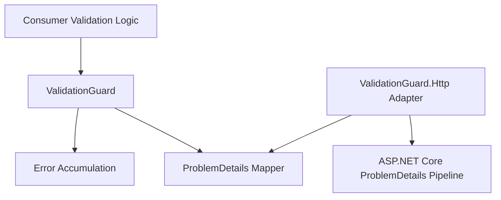
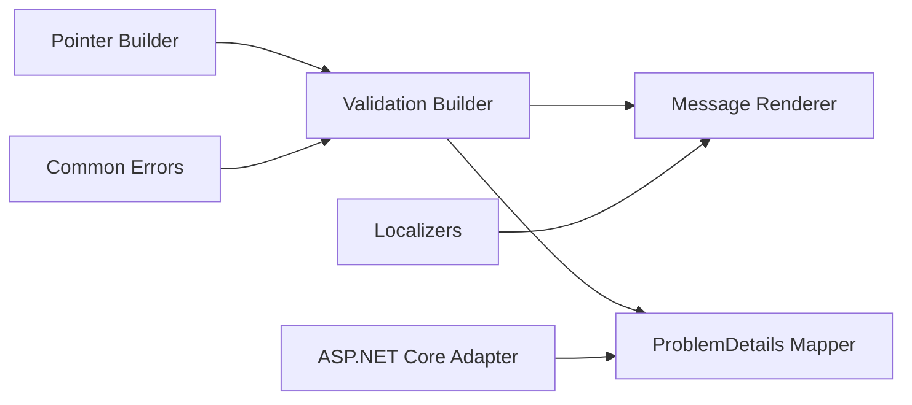
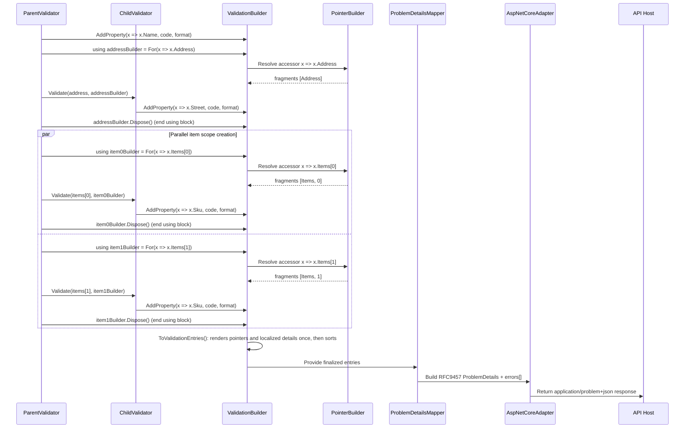

# Technical Design — ValidationGuard Typed Validation Error Accumulator

<!-- toc -->

- [1. Architecture Overview](#1-architecture-overview)
  - [1.1 Architectural Vision](#11-architectural-vision)
  - [1.2 Architecture Drivers](#12-architecture-drivers)
  - [1.3 Architecture Layers](#13-architecture-layers)
- [2. Principles & Constraints](#2-principles--constraints)
  - [2.1 Design Principles](#21-design-principles)
  - [2.2 Constraints](#22-constraints)
- [3. Technical Architecture](#3-technical-architecture)
  - [3.1 Domain Model](#31-domain-model)
  - [3.2 Component Model](#32-component-model)
  - [3.3 API Contracts](#33-api-contracts)
  - [3.4 Internal Dependencies](#34-internal-dependencies)
  - [3.5 External Dependencies](#35-external-dependencies)
  - [3.6 Interactions & Sequences](#36-interactions--sequences)
  - [3.7 Database schemas & tables](#37-database-schemas--tables)
- [4. Additional context](#4-additional-context)
- [5. Traceability](#5-traceability)
- [6. Changelog](#6-changelog)

<!-- /toc -->

## 1. Architecture Overview

### 1.1 Architectural Vision

ValidationGuard uses a layered library architecture with a strict separation between validation-domain modeling, accumulation orchestration, RFC 9457 projection, and ASP.NET Core transport integration. The core package is framework-focused and HTTP-agnostic, while the adapter package integrates with ASP.NET Core Problem Details pipelines.

The architecture is optimized for deterministic, machine-readable validation outputs for complex object graphs. Validation failures are accumulated as typed entries and preserved with RFC 6901 JSON Pointer addressing. The output model ensures stable field names (`pointer`, `code`, `format`, `detail`) under the `errors` extension while preserving standard Problem Details behavior.

The design prioritizes compatibility, composability, and predictable evolution. Core contracts are stable and versioned, with all public breaking changes gated behind major versions. Adapter behavior is additive and does not alter core failure semantics.

### 1.2 Architecture Drivers

Requirements that significantly influence architecture decisions.

**ADRs**: `ADR-001` ([Validation builder hierarchy and root-only materialization](./ADR/ADR-001-validation-builder-hierarchy-export.md)), `ADR-002` ([HTTP status mapping and Problem Details envelope selection](./ADR/ADR-002-http-status-mapping-and-problem-envelope.md)).

#### Functional Drivers

| Requirement | Design Response |
|-------------|------------------|
| Typed Error Registration | Define near-RFC validation entry model with explicit fields: `code`, `format`, `detail`, `pointer`. |
| Canonical Internal Entry Storage | Keep the builder's internal entry shape aligned with the Problem Details `errors` entry schema so projection is a field copy rather than a transformation. |
| Nested Object Path Handling | Provide path composition utility that generates RFC 6901 JSON Pointer for nested object members. |
| Array Element Path Handling | Support indexed pointer composition for collection traversal (`/items/0/name`). |
| Indexer and Keyed Path Handling | Resolve accessor indexers (`get_Item`) for keyed and numeric segments, RFC 6901-escape keyed tokens, and validate numeric index token correctness. |
| Configurable Pointer Fragment Naming | Resolve member-name segments through a pluggable fragment-name converter selected per validation operation, defaulting to unchanged member names; conversion precedes RFC 6901 escaping, which is applied to the original value. |
| Aggregation | Nested builders created from their parent (`For(accessor)`) record their entries locally; the root collects every node's entries without dropping any. |
| Deferred Rendering | Record entries as they are added and complete them (pointer, detail) once, when the root materializes them, under the cultures and options current at that moment. |
| Localization | Translate formats, entity and member names through `ValidationOptions.Localizers` (functions keyed by the text) for the current UI culture, and format values with the current culture; adapt `IStringLocalizer` in a separate package. |
| Common Errors | Ship ready-made error definitions with stable codes; ship their translations in a separate package so the errors carry no localization dependencies. |
| RFC 9457-Compatible Output | Store near-RFC validation entries in builder and emit standard Problem Details fields plus extension members with minimal transformation. |
| Errors Extension Projection | Persist `errors`-ready entries (`pointer`, `code`, `format`, `detail`) and serialize as deterministic extension array. |
| Deterministic Output Ordering | Enforce canonical deterministic ordering at root materialization via `ValidationEntryComparer` before serialization. |
| HTTP Status Derivation | Map codes to `(status, type, title)` through assembly-metadata declarations, fold entries by status precedence, and verify declarations with a bundled analyzer at build time. |

#### NFR Allocation

| NFR | NFR Summary | Allocated To | Design Response | Verification Approach |
|--------|-------------|--------------|-----------------|----------------------|
| Validation Serialization Performance | p95 <= 25 ms for 200 failures | ValidationBuilder and mapper layer | Near-RFC entry storage to minimize projection cost and low-allocation envelope construction | Automated performance tests for 200-entry payloads |
| Memory Efficiency | O(n) memory growth | ValidationBuilder + mapper pipeline | No retained request graph references; bounded transient allocations proportional to entry count | Memory profiling tests across increasing error counts |
| API Stability | SemVer contract stability | Public contract layer | Versioned contracts and major-only breaking changes | API compatibility checks during CI |
| Projection Efficiency | O(n) projection, bounded transient allocation | ValidationBuilder + mapper pipeline | Canonical internal entries projected directly without duplicate intermediate collections | Linear-time projection tests across increasing error counts |

### 1.3 Architecture Layers

| Layer | Responsibility | Technology |
|-------|---------------|------------|
| Presentation | API response surface via HTTP Problem Details | ASP.NET Core (`net10.0`) |
| Application | Validation orchestration and result composition | ValidationGuard (`net10.0`) |
| Domain | Validation entry model and pointer semantics | C# records/classes (`net10.0`) |
| Infrastructure | JSON serialization and hosting integration | `System.Text.Json`, ASP.NET Core ProblemDetails |

## 2. Principles & Constraints

### 2.1 Design Principles

#### RFC-First Error Envelope

All transport outputs follow RFC 9457 Problem Details semantics. Validation-specific data is carried only in extension members and never replaces standard Problem Details fields.

**ADRs**: None currently.

#### Stable Error Entry Contract

Validation entries must preserve a stable contract with `pointer`, `code`, `format`, and `detail` to enable predictable client mapping and long-term compatibility.

**ADRs**: `ADR-001` ([Validation builder hierarchy and root-only materialization](./ADR/ADR-001-validation-builder-hierarchy-export.md)).

### 2.2 Constraints

#### Strict Target Framework Constraint

Core and adapter libraries target strictly `net10.0`. No multi-targeting is included in this design scope.

**ADRs**: None currently.

## 3. Technical Architecture

### 3.1 Domain Model

**Technology**: C# domain model types and builder-driven accumulation (`net10.0`).

**Location**: [ValidationGuard core domain model](../src/ValidationGuard)

**Core Entities**:

| Entity | Description | Schema |
|--------|-------------|--------|
| ValidationEntry | Near-RFC validation failure entry with `pointer`, `code`, `format`, `detail`, optional metadata | [ValidationEntry](../src/ValidationGuard) |
| ValidationBuilder | Primary builder/accumulator used during validation traversal; nested builders record the entries of their scope | [ValidationBuilder](../src/ValidationGuard) |
| ValidationOptions | How entries are rendered: pointer naming convention, localizers, whether to localize, how text and values are written | [ValidationOptions](../src/ValidationGuard/Builders/ValidationOptions.cs) |
| ValidationMetadata | Typed values of an entry: renders its detail from the (localized) format and writes itself to JSON | [Metadata](../src/ValidationGuard/Metadata) |
| ErrorDefinition | A reusable error: code, English format and keys, checked by `ErrorDefinitionValidator` | [ValidationGuard.CommonErrors](../src/ValidationGuard.CommonErrors) |
| ProblemDetailsProjection | Mapping output model for RFC 9457 + `errors` extension | [ValidationGuard.Http](../src/ValidationGuard.Http) |
| HttpErrorCode | Code-to-`(status, type, title)` mapping declared in assembly metadata | [ValidationGuard.Http](../src/ValidationGuard.Http) |

**Relationships**:
- ValidationBuilder → ValidationEntry: creates and aggregates entries.
- ValidationBuilder → ProblemDetailsProjection: provides finalized, deterministic entries to RFC 9457 projection.

### 3.2 Component Model

#### Pointer Builder

##### Why this component exists

Ensures all path addressing is emitted as RFC 6901 JSON Pointer and prevents ad-hoc path string drift.

##### Responsibility scope

Build and normalize pointer segments for properties, array indices, and indexer access (`get_Item`) including escaping rules defined by RFC 6901 and numeric array-index token validation.

##### Responsibility boundaries

Does not perform validation logic or serialization; only pointer composition and normalization.

##### Related components

- Validation Builder — called by builder to attach stable pointers.

#### Validation Builder

##### Why this component exists

Provides the primary accumulation surface for validators across nested validation scopes.

##### Responsibility scope

Register entries with a `code`, a `format` and optional metadata; create nested builders that hold their own path fragments, relative to their parent, and keep scoped entries per builder node; support `using { ... }` lifetime for nested builder disposal; materialize deterministic flattened output from the root builder (`ToValidationEntries()`), which completes the whole hierarchy once: pointers are composed from the fragments of the builders on the way down, details are rendered by the Message Renderer, and no entry can be added afterwards. `Valid` counts entries without rendering.

##### Responsibility boundaries

Does not handle HTTP transport concerns or ASP.NET Core pipeline wiring. Nested validators remain path-agnostic and do not infer containment location. Nested builders isolate scope context per branch and keep local entries; only the root builder materializes the full hierarchy, and only `ValidationBuilder<TContext>` (sealed) can, as no other assembly can derive from `ValidationBuilderBase<TContext>`. Hierarchy traversal uses `IValidationBuilderNode` as an internal abstraction to support mixed generic child node traversal.

##### Related components

- Pointer Builder — depends on for pointer generation.
- Message Renderer — renders each entry's detail at materialization.
- ProblemDetails Mapper — provides root-materialized entries for mapping.

#### Message Renderer

##### Why this component exists

Renders an entry's detail from its format and metadata in the request's language, once, when the root materializes the entries.

##### Responsibility scope

`ValidationMessageWriter` localizes each format, entity name and member name through `ValidationOptions.Localizers` (functions returning the translation of a text for the current UI culture, or null; the first translation wins, and each text is looked up once per rendering), fills the placeholders through the entry's metadata, and formats values with the current culture, including format specifiers. With `UseLocalization` off, texts are left as defined and values use the invariant culture. A failing localizer leaves the text untranslated, and an invalid specifier is dropped (the value is formatted without it), rather than failing the response. Entries are ordered by pointer, code and the format as added, so translations never change the order.

##### Responsibility boundaries

Does not own translations: libraries and applications supply localizers. `ValidationGuard.Localization` adapts `IStringLocalizer`; `ValidationGuard.CommonErrors.Localization` ships the common errors' resources. Pointers are never localized.

##### Related components

- Validation Builder — invokes it while materializing.

#### Common Errors

##### Why this component exists

Gives applications and libraries ready-made errors with stable codes, formats and typed metadata, and the means to define their own the same way.

##### Responsibility scope

`ValidationGuard.CommonErrors` provides the error definitions (`CommonErrorDefinitions`), typed `Add...` helpers, their metadata types and `ErrorDefinitionValidator`, which checks definitions and translations. Its translations, keyed by the English format, ship in `ValidationGuard.CommonErrors.Localization`; its HTTP statuses in `ValidationGuard.CommonErrors.Http`.

##### Responsibility boundaries

Depends only on the core package: no localization or HTTP dependency.

##### Related components

- Validation Builder — its helpers add entries to builders.

#### ProblemDetails Mapper

##### Why this component exists

Transforms domain validation results into RFC 9457-conformant output with stable extension structure.

##### Responsibility scope

Generate a Problem Details object and attach `errors` array entries containing `pointer`, `code`, `format`, `detail`, and nested `metadata` when present, writing them straight from builder entries without intermediate objects.

Select the envelope from the entries (see `ADR-002`):

- Resolve each entry's code to `(status, type, title)` through `ErrorCodeMap`; unmapped codes take the fallback status (422 by default) and are logged.
- The response status is the highest-ranked status under `StatusPrecedence` (default `403 > 404 > 409 > 422 > 400`).
- When exactly one entry holds the highest rank, use its code's declared `type` and `title`, and put the entry's `detail` into the Problem Details `detail`.
- When several entries hold the highest rank, leave `type`, `title` and `detail` unset.
- Leave any undeclared `type` or `title` unset so ASP.NET Core applies its generic status-derived values; `title` never carries occurrence-specific text (RFC 9457 §3.1.3).
- Always include every entry in the `errors` extension.

Implemented by `ValidationProblemFactory`, `ErrorCodeMap`, `StatusPrecedence` and `ValidationErrorsJsonConverter` in `ValidationGuard.Http`.

##### Responsibility boundaries

Does not own validation rule execution or web framework middleware registration. Does not validate mapping values at runtime; status ranges, URIs and in-assembly duplicates are enforced by the analyzer at build time.

##### Related components

- Validation Builder — consumes root-materialized entries.
- ASP.NET Core Adapter — used by adapter integration.

#### ASP.NET Core Adapter

##### Why this component exists

Separates transport integration concerns from core validation-domain concerns while simplifying ASP.NET Core adoption.

##### Responsibility scope

Integrate with ASP.NET Core ProblemDetails pipeline, convert validation results to HTTP responses, and preserve response media type compatibility.

Collect code mappings declared with `[assembly: HttpErrorCode]` and `[assembly: HttpErrorCodeOverride]` from the assemblies the application registers through `services.AddValidationProblems(codes => codes.AddAssemblyOf<T>())`. Adding a code twice throws; overrides apply when the map is built, regardless of registration order.

Ship the `ValidationGuard.Http.Analyzers` Roslyn analyzer inside the same NuGet package so declaration mistakes fail the build of the declaring assembly. Code collisions between referenced packages are reported as build warnings (VGH005), because the analyzer cannot tell whether the application registers both packages; registering both throws when the map is built at startup.

##### Responsibility boundaries

Does not change core entry semantics or pointer conventions.

##### Related components

- ProblemDetails Mapper — delegates payload projection.

### 3.3 API Contracts

- **Contracts**: Errors Extension Consumer Contract, ASP.NET Core ProblemDetails Integration, ASP.NET Core Adapter Package
- **Technology**: .NET public interfaces/types + HTTP `application/problem+json`
- **Location**: [Public contracts](../src)

Core library contracts are type/interface-based. HTTP endpoints are owned by consuming applications; the adapter provides integration with ASP.NET Core Problem Details infrastructure.

ValidationBuilder scope/addressing API uses accessor expressions instead of raw string segments for member/index selection, for example:
- Property scope: `x => x.Property`
- Nested object scope: `x => x.Nested`
- Indexed scope: `x => x[5]`
- Keyed/indexer scope: `x => x.Metadata["key"]`, `x => x.Bag["region"]`

These accessors are resolved to path fragments held by the nested builder; the pointer is composed from the fragments of every builder from the root when the entries are materialized, and RFC 6901-escaped then.

### 3.4 Internal Dependencies

| Dependency Module | Interface Used | Purpose |
|-------------------|----------------|----------|
| ValidationGuard | Internal domain contracts | Entry and builder modeling; no package dependencies |
| ValidationGuard.Localization | `options.Localizers.Add(IStringLocalizer)`, `Translate` | Localizes messages with `IStringLocalizer` |
| ValidationGuard.CommonErrors | `ErrorDefinition`, `CommonErrorDefinitions`, `ErrorDefinitionValidator` | Ready-made errors and the means to define and check others |
| ValidationGuard.CommonErrors.Localization | `IStringLocalizer<CommonErrorMessages>` resources | Translations of the common errors to 47 languages |
| ValidationGuard.CommonErrors.Http | `AddCommonErrors()` | HTTP statuses of the common error codes |
| ValidationGuard.Http | `ValidationProblemFactory`, `ErrorCodeMapBuilder`, `HttpErrorCode` attributes | RFC 9457 projection, HTTP status derivation, and ASP.NET Core integration |
| ValidationGuard.Http.Analyzers | Roslyn diagnostics `VGH001`–`VGH007` | Build-time verification of HTTP code declarations; packed into the `ValidationGuard.Http` NuGet package |

**Dependency Rules** (per project conventions):
- No circular dependencies
- Always use SDK modules for inter-module communication
- No cross-category sideways deps except through contracts
- Only integration/adapter modules talk to external systems
- `SecurityContext` must be propagated across all in-process calls

### 3.5 External Dependencies

#### ASP.NET Core ProblemDetails

| Dependency Module | Interface Used | Purpose |
|-------------------|---------------|---------|
| Microsoft.AspNetCore.Http.Abstractions / ProblemDetails | RFC 9457-compatible ProblemDetails model | HTTP error envelope interoperability |

#### Microsoft.Extensions.Localization

| Dependency Module | Interface Used | Purpose |
|-------------------|---------------|---------|
| Microsoft.Extensions.Localization(.Abstractions) | `IStringLocalizer`, `[ResourceLocation]`, `[RootNamespace]` | Adapter and resource-based translations; referenced only by the `.Localization` packages |

#### System.Text.Json

| Dependency Module | Interface Used | Purpose |
|-------------------|---------------|---------|
| System.Text.Json | JSON serialization primitives | Serialize Problem Details and `errors` extension entries |

**Dependency Rules** (per project conventions):
- No circular dependencies
- Always use SDK modules for inter-module communication
- No cross-category sideways deps except through contracts
- Only integration/adapter modules talk to external systems
- `SecurityContext` must be propagated across all in-process calls

### 3.6 Interactions & Sequences

#### Validation Failure to Problem Details Response

**Use cases**: Return nested validation errors for request DTO

**Actors**: API Developer, ASP.NET Core API Host

**Description**: Containing validators create nested builders through accessor expressions and pass them to nested validators. Accessors are resolved to path fragments before nested validation begins; pointers and details are rendered only when the root materializes the entries. Each builder node stores scoped entries locally, and the root builder flattens the full hierarchy during `ToValidationEntries()`. This model supports independent parallel branches (for example multiple array element scopes) without scope leakage while preserving deterministic output ordering.

### 3.7 Database schemas & tables

This library design does not include persistent storage requirements. Validation failures are transient and request-scoped.

## 4. Additional context

Capacity and cost are primarily governed by payload size and serialization overhead. For current scope, the architecture targets predictable O(n) scaling with the number of validation entries and bounded per-request transient allocations.

The adapter package is intentionally separate to keep the core library reusable in non-HTTP scenarios while still providing first-class ASP.NET Core integration.

## 5. Traceability

- **PRD**: [PRD.md](./PRD.md)
- **ADRs**: [ADR/](./ADR/)

## 6. Changelog

| Version | Date | Change |
|---------|------|--------|
| 1.3.0 | 2026-10-27 | Deferred rendering, options, localization and common errors: Message Renderer and Common Errors components, drivers and package dependencies; nested builders hold path fragments instead of pointer prefixes; merging removed. |
| 1.2.0 | 2026-10-14 | Added HTTP Status Derivation driver and `ADR-002`; specified envelope selection for the ProblemDetails Mapper; replaced the planned Mapping and AspNetCore modules with `ValidationGuard.Http` and its bundled analyzer. |
| 1.1.0 | 2026-08-24 | Added Functional Drivers rows for Canonical Internal Entry Storage and Configurable Pointer Fragment Naming. |
| 1.0.0 | 2026-08-06 | Initial DESIGN. |
